# StockSense VN (IDSS) – Use case và biểu đồ tuần tự

Cập nhật: 31/10/2026. Dùng để vẽ lại trên Visual Paradigm. Mã UC-01..UC-29 giữ đúng như PRD v0.0.4; UC-30, UC-31 là chức năng bổ sung (bảng giá, biểu đồ nến). Biểu đồ tuần tự mô tả đúng luồng đang chạy trong code (đường dẫn API, bảng CSDL); SD-16 là luồng thiết kế cho mô hình AI.

Cột "Hiện trạng": **Đạt** = chạy đầy đủ; **Một phần** = chạy nhưng phần dự báo/giải thích còn dữ liệu mẫu hoặc chờ mô hình; **Chưa** = chưa làm.

---

## 1. Tác nhân (actor)

Hệ thống phân quyền theo **4 vai trò**: Retail, Trader, Analyst, Admin. Các tác nhân còn lại trên sơ đồ use case không phải vai trò: "Khách" là người chưa đăng nhập, "Hệ thống" là lịch chạy tự động, còn SSI, CafeF, SMTP, Telegram là hệ thống bên ngoài.

| Tác nhân | Loại | Mô tả |
| --- | --- | --- |
| Khách | Người chưa đăng nhập (không phải vai trò) | Chưa có tài khoản; chỉ đăng ký (tạo tài khoản Retail), xác thực email, quên mật khẩu |
| Nhà đầu tư cá nhân (Retail) | Người | Xem thị trường, dự báo, tin, watchlist, cảnh báo, Portfolio, Trade Plan rút gọn, Journal, Chat, PDF |
| Trader | Người | Kế thừa Retail; thêm lưu bộ lọc, import CSV, vốn và % rủi ro, Journal thủ công và thống kê |
| Analyst | Người | Kế thừa Trader; thêm xuất CSV lịch sử, xem nhật ký Chat, (sau) audit/tái lập dự báo, đánh giá mô hình |
| Admin | Người | Quản trị người dùng, duyệt nâng quyền, job dữ liệu, nhật ký quản trị, nhật ký thông báo, nhật ký Chat |
| Hệ thống (lịch 15:30) | Thời gian | Worker tự chạy pipeline dữ liệu sau phiên các ngày giao dịch |
| SSI iBoard | Hệ thống ngoài | Giá ngày (giá khớp + giá điều chỉnh) của 15 mã và chỉ số VN-Index, HNX-Index, VN30 |
| CafeF, VnExpress | Hệ thống ngoài | Tin theo chuyên mục và tin theo từng mã |
| Máy chủ SMTP (Gmail) | Hệ thống ngoài | Gửi thư xác thực, đặt lại mật khẩu, mã xác minh, cảnh báo |
| Telegram Bot API | Hệ thống ngoài | Liên kết tài khoản Telegram, gửi cảnh báo |

**Quan hệ tổng quát hóa (generalization):** Trader → Retail; Analyst → Trader. Admin không kế thừa vai trò người dùng cuối.

---

## 2. Danh sách use case

| UC | Tên | Tác nhân chính | Hiện trạng |
| --- | --- | --- | --- |
| UC-01 | Xem tín hiệu các mã trên trang tổng quan | Retail, Trader, Analyst | Một phần (dự báo mẫu; giá, chỉ số, độ rộng thật) |
| UC-02 | Xem thẻ dự báo và lý do dự báo của một mã | Retail, Trader, Analyst | Một phần (thẻ dự báo mẫu; chưa có lý do) |
| UC-03 | Xem tin mới và sắc thái tin của một mã | Retail, Trader, Analyst | Một phần (tin thật từ 2021; sắc thái chờ mô hình) |
| UC-04 | Thêm mã vào watchlist | Retail, Trader, Analyst | Đạt |
| UC-05 | Đặt ngưỡng và nhận cảnh báo trong ứng dụng | Retail, Trader, Analyst | Một phần (cảnh báo giá, Trade Plan; ngưỡng xác suất chờ mô hình) |
| UC-06 | So sánh dự báo T+2 với T+5 | Trader | Một phần (dữ liệu mẫu) |
| UC-07 | Lọc, sắp xếp, tìm kiếm danh sách mã | Trader | Một phần (thiếu lọc/sắp theo dự báo) |
| UC-08 | Xem lịch sử dự báo và hit rate | Trader | Chưa |
| UC-09 | Xem đóng góp của từng đặc trưng | Analyst | Chưa |
| UC-10 | Xem dữ liệu đầu vào và tái lập dự báo | Analyst | Chưa |
| UC-11 | So sánh mô hình baseline với đa phương thức | Analyst, Admin | Chưa |
| UC-12 | Quản lý tài khoản và vai trò | Admin | Đạt |
| UC-13 | Xem nguồn dữ liệu và chạy lại job | Admin | Đạt |
| UC-14 | Chọn phiên bản mô hình, quay lại bản trước | Admin | Chưa |
| UC-15 | Sàng lọc cổ phiếu bằng Screener | Retail, Trader, Analyst | Một phần (thiếu điều kiện theo dự báo) |
| UC-16 | Ghi giao dịch và xem danh mục | Retail, Trader, Analyst | Đạt (trừ tín hiệu cạnh vị thế) |
| UC-17 | Lập và theo dõi Trade Plan | Retail, Trader, Analyst | Đạt (trừ snapshot dự báo) |
| UC-18 | Xem và ghi Journal | Retail, Trader, Analyst | Đạt (trừ so sánh với dự báo) |
| UC-19 | Hỏi đáp bằng Chat | Retail, Trader, Analyst | Một phần (trả lời theo dữ liệu, chưa dùng mô hình ngôn ngữ) |
| UC-20 | Xuất báo cáo PDF | Retail, Trader, Analyst | Một phần (chưa có giải thích, hit rate) |
| UC-21 | Nhận thông báo qua email và Telegram | Retail, Trader, Analyst, Admin | Đạt |
| UC-22 | Dùng ứng dụng trên điện thoại | Retail, Trader, Analyst | Chưa (GĐ3) |
| UC-23 | Đăng nhập, đăng xuất, đổi/quên mật khẩu | Mọi người dùng | Đạt |
| UC-24 | Chạy pipeline tự động sau mỗi phiên | Hệ thống | Một phần (giá, chỉ số, tin, cảnh báo, thông báo; bước dự báo chờ mô hình) |
| UC-25 | Xem nhật ký hành động quản trị | Admin | Đạt |
| UC-26 | Tự đăng ký và xác thực email | Khách | Đạt |
| UC-27 | Nâng cấp Trader, yêu cầu quyền Analyst | Retail, Trader | Đạt |
| UC-28 | Duyệt hoặc từ chối yêu cầu nâng quyền | Admin | Đạt |
| UC-29 | Tạo Admin, xem đồng ý, xóa tài khoản | Admin, Retail, Trader, Analyst | Đạt |
| UC-30 | Xem bảng giá cuối ngày (bổ sung) | Retail, Trader, Analyst | Đạt |
| UC-31 | Xem biểu đồ nến và chỉ báo kỹ thuật (bổ sung) | Retail, Trader, Analyst | Đạt |

### 2.1 Quan hệ giữa các use case (vẽ trên sơ đồ)

| Quan hệ | Từ | Tới | Ý nghĩa |
| --- | --- | --- | --- |
| «include» | Mọi UC của người dùng đã đăng nhập (trừ UC-26) | UC-23 Đăng nhập | Phải có phiên đăng nhập hợp lệ |
| «extend» | UC-04 Thêm watchlist | UC-01, UC-30, UC-31 | Nút thêm watchlist trên tổng quan, bảng giá, trang mã |
| «extend» | UC-17 Lập Trade Plan | UC-31 (trang mã), UC-15 | Lập kế hoạch từ trang mã hoặc kết quả Screener |
| «extend» | UC-18 Journal | UC-17 | Đóng Trade Plan tự tạo bản ghi Journal |
| «extend» | UC-21 Thông báo ngoài app | UC-05 | Cảnh báo được gửi thêm qua email/Telegram nếu bật kênh |
| «extend» | UC-20 Xuất PDF | UC-31, UC-16, UC-17, UC-18 | Nút xuất PDF trên từng màn hình |
| «include» | UC-24 Pipeline | UC-05 | Pipeline tạo cảnh báo giá và cảnh báo Trade Plan |
| «include» | UC-27 Yêu cầu Analyst | UC-28 | Yêu cầu chỉ có hiệu lực khi Admin duyệt |
| Liên kết | UC-24 | SSI iBoard, CafeF/VnExpress | Nguồn dữ liệu ngoài |
| Liên kết | UC-21, UC-26, UC-23 (quên mật khẩu) | Máy chủ SMTP, Telegram Bot API | Kênh gửi thư/tin nhắn |

### 2.2 Đặc tả ngắn các use case bổ sung

**UC-30. Xem bảng giá cuối ngày**

| Mục | Nội dung |
| --- | --- |
| Tác nhân | Retail, Trader, Analyst |
| Điều kiện trước | Đã đăng nhập |
| Luồng chính | 1. Người dùng mở "Bảng giá". 2. Hệ thống trả 15 mã với tham chiếu, trần, sàn, đóng cửa, +/−, %, mở/cao/thấp, khối lượng, giá trị, dự báo T+2/T+5; tô màu tím trần, xanh lam sàn, vàng tham chiếu, xanh tăng, đỏ giảm. 3. Người dùng lọc theo sàn/ngành, tìm mã, lọc watchlist, sắp xếp. 4. Bấm một mã để mở UC-31. |
| Quy tắc | Tham chiếu = giá đóng cửa phiên trước (UPCoM: giá bình quân); ngày giao dịch không hưởng quyền dùng giá đã điều chỉnh; trần/sàn theo biên độ ±7% (HOSE), ±10% (HNX), ±15% (UPCoM), làm tròn theo bước giá. Dữ liệu cuối ngày, không đặt lệnh. |

**UC-31. Xem biểu đồ nến và chỉ báo kỹ thuật**

| Mục | Nội dung |
| --- | --- |
| Tác nhân | Retail, Trader, Analyst |
| Điều kiện trước | Đã đăng nhập, mã nằm trong 15 mã theo dõi |
| Luồng chính | 1. Người dùng mở trang mã (tab "Giao dịch"). 2. Hệ thống hiển thị khối giá (tham chiếu/trần/sàn, % 1 tuần/1 tháng/3 tháng/từ đầu năm, cao/thấp 52 tuần, trạng thái dữ liệu), biểu đồ nến 5 năm theo giá điều chỉnh kèm khối lượng, và thẻ dự báo T+2/T+5. 3. Người dùng chọn khung Ngày/Tuần/Tháng, khoảng 1T–3N–Tất cả, bật/tắt MA20, MA50, đánh dấu tin, RSI(14), MACD. 4. Rê chuột để xem O/H/L/C và khối lượng của phiên. |
| Mở rộng | Thêm watchlist (UC-04), lập Trade Plan (UC-17), xuất PDF (UC-20), xuất CSV (Analyst). |

---

## 3. Thành phần trên biểu đồ tuần tự

| Lifeline | Thực tế trong code |
| --- | --- |
| Người dùng | Trình duyệt của người dùng |
| Web | React + Vite (`apps/web`) |
| API | Node.js + Fastify (`apps/api`), REST `/api/v1`, phiên bằng cookie HttpOnly |
| CSDL | PostgreSQL 17 |
| Worker | Node.js (`apps/worker`): `admin-jobs:watch`, `market:sync`, `news:sync`, `notifications:deliver` |
| SSI, CafeF, SMTP, Telegram | Hệ thống ngoài |

Mọi request sau khi đăng nhập đều qua bước kiểm tra phiên: API băm token trong cookie, tra `auth_sessions` + `users` (còn hạn, chưa thu hồi, tài khoản hoạt động), rồi kiểm tra quyền (capability) của vai trò. Bước này không vẽ lặp lại trong từng biểu đồ.

---

## 4. Biểu đồ tuần tự

### SD-01. Tự đăng ký và xác thực email (UC-26)

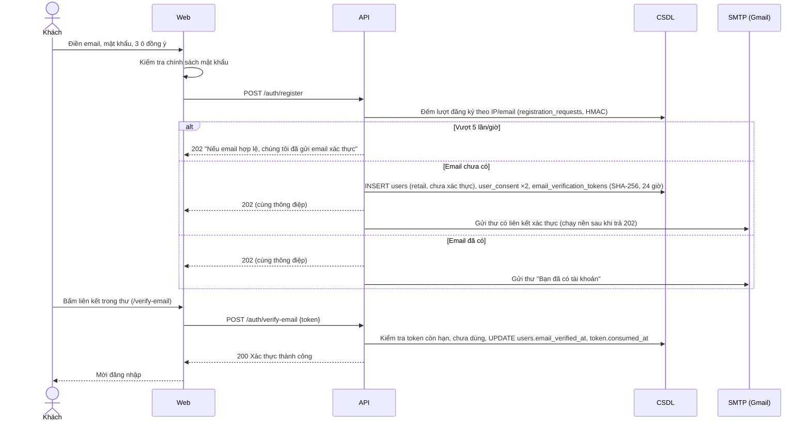

### SD-02. Đăng nhập, khóa tạm khi sai nhiều lần (UC-23)

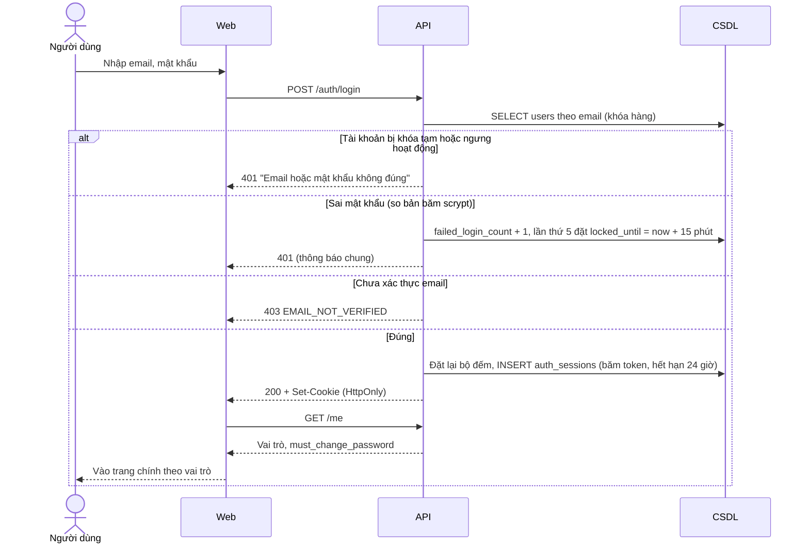

### SD-03. Quên mật khẩu (UC-23)

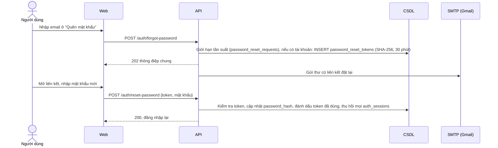

### SD-04. Nâng cấp Trader, yêu cầu Analyst và Admin duyệt (UC-27, UC-28)

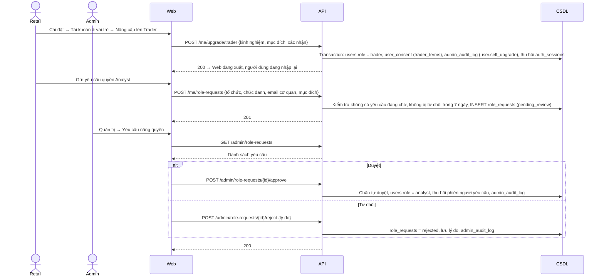

### SD-05. Xem bảng giá (UC-30)

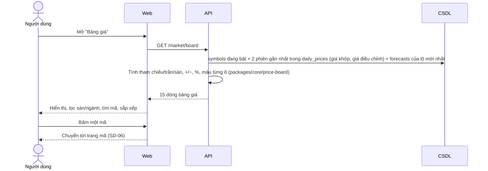

### SD-06. Xem trang mã, biểu đồ nến và chỉ báo (UC-31, UC-02, UC-03)

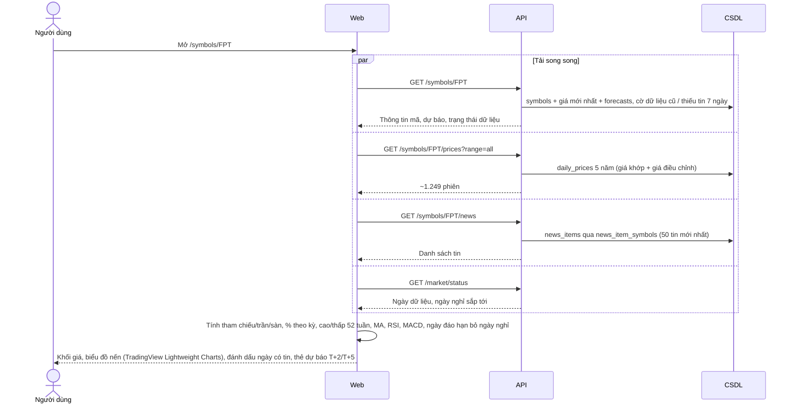

### SD-07. Thêm watchlist và đặt cảnh báo giá (UC-04, UC-05)

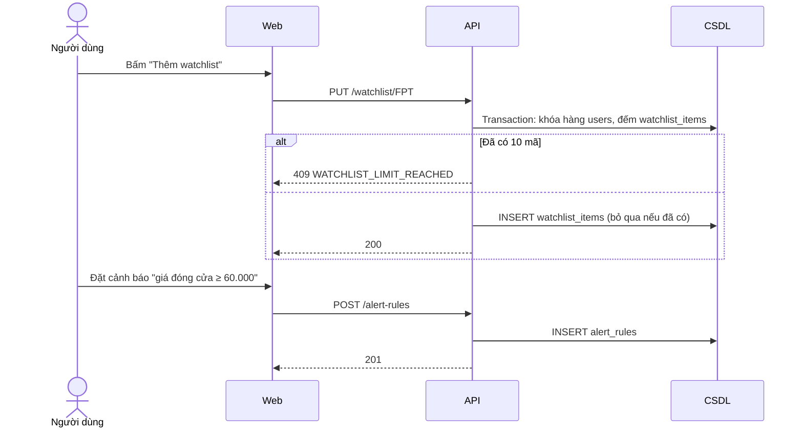

### SD-08. Pipeline dữ liệu sau phiên 15:30 (UC-24, UC-05, UC-21)

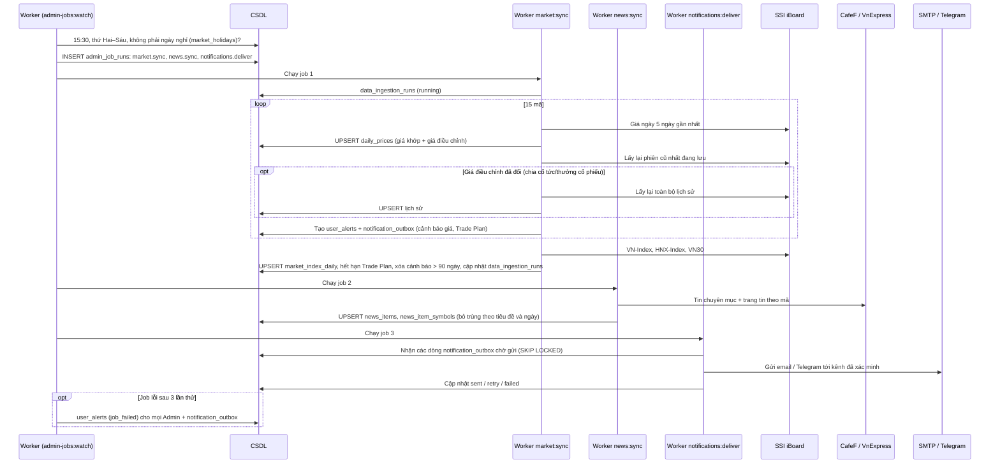

### SD-09. Liên kết kênh thông báo email và Telegram (UC-21)

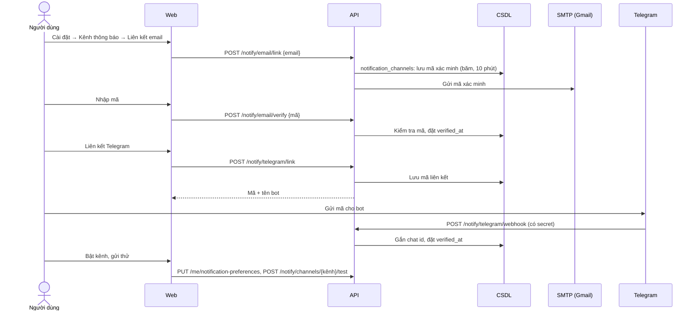

### SD-10. Ghi giao dịch và import CSV vào Portfolio (UC-16)

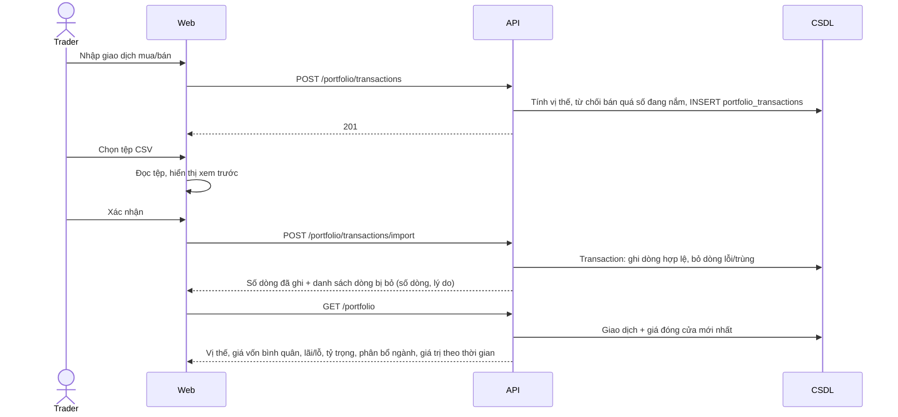

### SD-11. Trade Plan: lập, cảnh báo, đóng và tạo Journal (UC-17, UC-18)

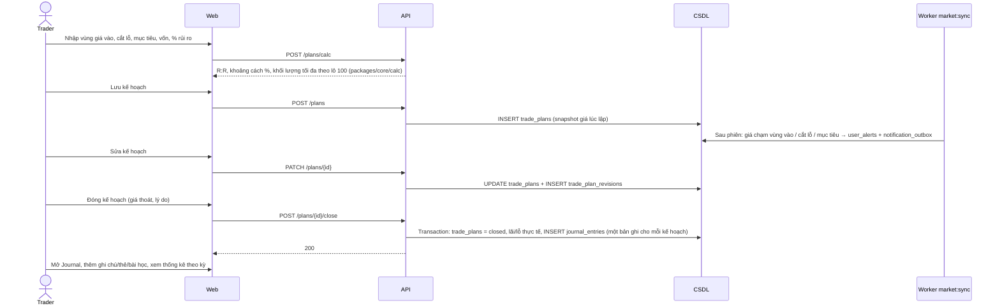

### SD-12. Chat hỏi đáp theo dữ liệu (UC-19)

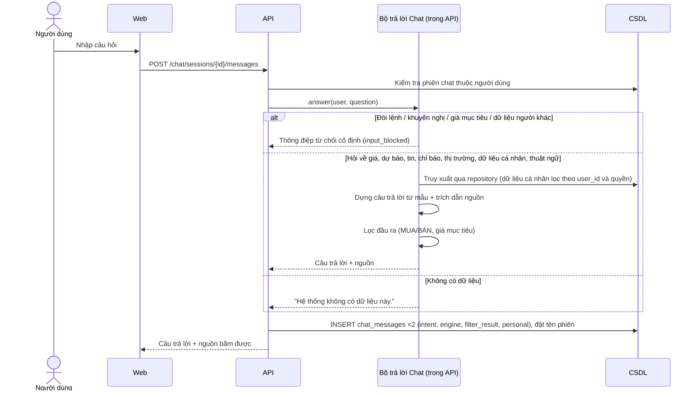

### SD-13. Xuất báo cáo PDF (UC-20)

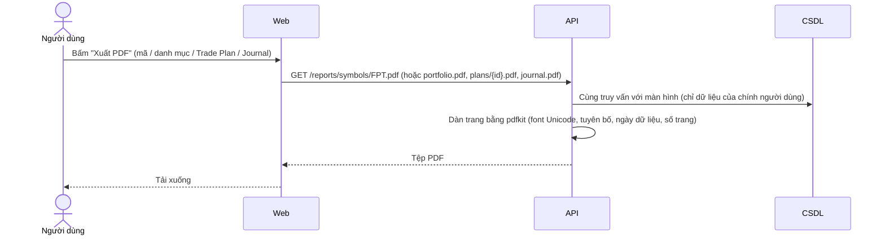

### SD-14. Admin xem nguồn dữ liệu và chạy lại job (UC-13, UC-25)

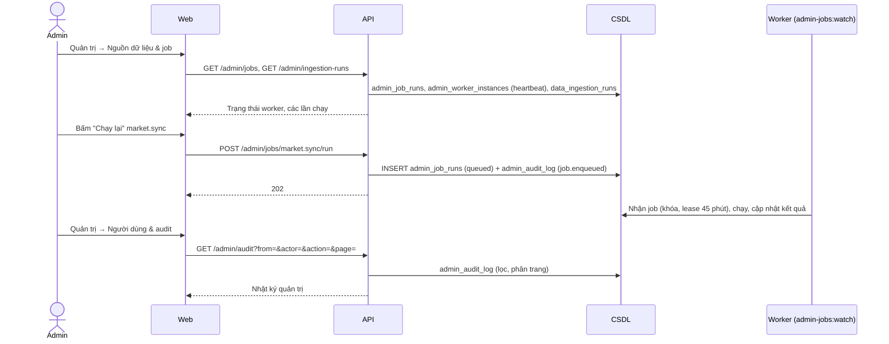

### SD-15. Tự xóa tài khoản (UC-29)

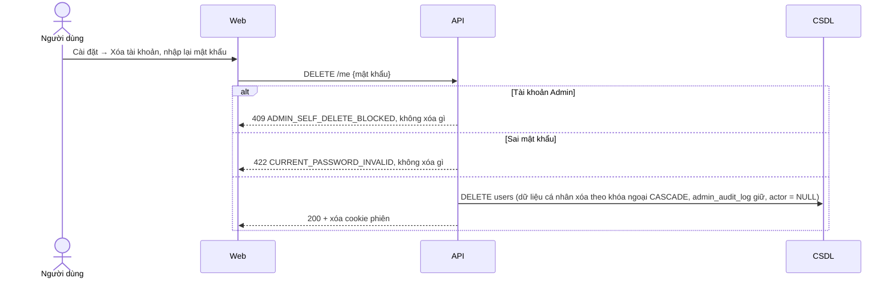

### SD-16. Sinh dự báo hằng ngày – thiết kế cho mô hình AI (UC-24, chưa triển khai)

Dùng các bảng ở phần B của `CSDL_StockSenseVN.sql`.

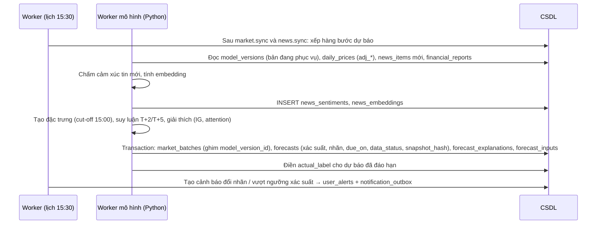
